# Cactus Peak Athletic — Member web app: flows

Read `01-product-and-ia.md` first for citation tags, roles and the rule IDs [P#] (the rules now live in `../00-foundation.md` §4; see file 01 §9). Shared component names and variants follow `../01-shared-brand-components*.md`.
Today in all examples: **Tuesday, Oct 27, 2026**, 5:40 a.m. Arizona time. Maya's billing day: the 12th. Component names are defined in `04-components.md`. Page layouts are in `03-pages.md`.

Every flow below has: trigger, numbered steps (screen or state, member action, system response), decisions, errors and edge cases, confirmation and undo, and a diagram.

## Shared: booking states (used by every booking flow)

`BookingStateButton` is the shared component (shared §8.1). It has 12 states: `book`, `booking`, `booked`, `waitlist`, `waitlisted`, `hold`, `full`, `late-cancel`, `paused`, `restricted`, `started`, `error`. The web app uses those names and labels and does not add states. The shared function `deriveBookingState` computes the state. Labels are the shared labels:

| State id | Label | App usage and reason line |
|---|---|---|
| `book` | Book | "12 spots left". A spot that opened inside the last hour is a **drop-in spot**: state `book` with the line "Drop-in spot. The waitlist is closed." |
| `booking` | Booking… | Optimistic; spinner; `aria-busy` |
| `booked` | Booked (check icon) | "Manage" menu: Add to calendar, Cancel booking. In the sticky bar: "Booked" text plus a grey outline "Cancel" (mobbin-standard-pass §2 rule 40) |
| `waitlist` | Join waitlist | "Full. 3 people waiting." Opens the waitlist dialog (Flow 4) |
| `waitlisted` | On waitlist #3 | Menu: Leave waitlist. Position is live |
| `hold` | Confirm spot · 28:41 | 30-minute hold. Timer is tabular. Secondary ghost "Release" is an app addition, not a shared state |
| `full` | Full | Reason line "Waitlist closed 1 hour before start" |
| `late-cancel` | Booked + `LateCancelNotice` | Cancel menu item reads "Cancel (late)" |
| `paused` | Booking paused | Reason "Back on Oct 30". Applies to classes, courts and lanes only [P3] |
| `restricted` | Ridge only (label comes from the reason) | Disabled or outline with a reason line. Used for every "you cannot book this" case that is not a pause (table below) |
| `started` | Started | Booking closes at start time |
| `error` | Try again | Message under the button |

**Cases the shared state list does not name.** The app maps them onto `restricted` (disabled, with a `reason` line, and a link when there is a next step). The shared spec says `restricted` covers Trailhead at a non-home club; the cases below extend that use. **Request to the shared spec owner:** add a `reason`-driven label for `restricted`, and consider a `not-open` state. Until then the app passes these reasons:

| Case | `restricted` reason line | Link |
|---|---|---|
| Window not open yet | "Opens Wed, Oct 28 at 6:00 a.m." | "Remind me" |
| Trailhead at another club | "Trailhead books at Mesa – Dobson only." (label "Ridge only") | "See plans" |
| Courts on Trailhead | "Courts come with Ridge and Summit." | "Compare plans" |
| Frozen membership | "Your membership is frozen until Jan 11." | "Resume early" |
| Payment hold (day 8 on) | "Update your card to book. Your bookings are safe." | "Update card" |
| Age rule | "For ages 13 and up." / "Sauna and cold plunge are 18 and over." / "Strength floor without a coach is 16 and over." | — |
| Teen needs approval | "This class needs Alicia's OK." | "Ask Alicia" (Flow 19) |
| Class ended | `started` | — |
| Overlap with another booking | Not a state: the conflict dialog opens when the member presses `book` | — |

Rules: label starts with a verb where an action exists. State never relies on colour alone: each state has an icon and text. A price or unit is always written out (W §5 a2). The button keeps its width when the label changes (shared §8.1 "State rules").

---

## Flow 1 — Sign in (password-free first; passkey and magic link)

**Trigger:** member opens any `my.` URL while signed out, or follows the email invite after joining on the marketing site.
**Screens:** `/sign-in`, `/sign-in/verify`, `/sign-in/link/[token]`. Layout from `login-03` (form column + photo column at ≥1024 px; photo hidden below) (CL §3).

| # | Screen / state | Member does | System does |
|---|---|---|---|
| 1 | `/sign-in` default. Email `Input` (autocomplete `username webauthn`), primary "Continue with email", outline "Sign in with a passkey" (icon `KeyRound`), text link "Use a password instead". Footer: "Not a member yet? See plans" (to marketing site). | Opens page. | If the browser offers conditional-UI passkeys, shows them in the email autofill list. Focus goes to the email field. |
| 2a | **Passkey path.** | Chooses a passkey from autofill or presses the passkey button. | Starts WebAuthn. On success: step 6. |
| 2b | **Email path.** Button label becomes "Sending…". | Types email, presses Continue. | Sends one email with a magic link and a 6-digit code. Always shows step 3, even when no account exists (no account probing). |
| 2c | **Password path.** Password field appears. Paste is allowed. | Types or pastes (WCAG 3.3.8). | Verifies. On success: step 6. |
| 3 | `/sign-in/verify`. Heading "Check your email". Text "We sent a link and a 6-digit code to ron@example.com. They work for 10 minutes." `OTPField` (6 boxes). "Resend" disabled for 30 s, then enabled. "Use a different email". | Types or pastes the code, or opens the link. | Auto-submits on the 6th digit. `aria-live` announces "Checking code…". |
| 4 | **Link opened** at `/sign-in/link/[token]`: heading "Sign in as Ron?" with button "Sign in". | Presses Sign in. | One-time use. The confirm button stops email scanners from using the token. |
| 5 | Wrong or expired code | Retries. | Inline error. After 5 wrong codes: lock for 15 minutes. |
| 6 | Success | — | Create session cookie (30 days, sliding). If `next` param is a same-origin path, go there. If first sign-in, go to `/welcome`. Else `/today`. |
| 7 | Today, first visit after sign-in | — | Dismissible card: "Sign in faster next time. Add a passkey." → `/settings/security`. Never blocks. |

**Decisions and errors**
- No account for the email: step 3 still shows. The email says "We don't have an account for this address. Joining takes 3 minutes." with a link to plans. The page never says whether the email exists.
- Code wrong: "That code isn't right. Check the 6 digits, or send a new one."
- Code expired: "That code expired. We sent a new one." (auto-send once).
- Link used twice: "This link was already used. Enter the code from the same email, or ask for a new link."
- Passkey cancelled: no error toast. Focus returns to the button.
- Passkey not found on this device: "We couldn't find a passkey on this device. Use email instead."
- Offline: inline banner "You're offline. Connect to sign in."
- Rate limit: "Too many tries. Wait 15 minutes, or call (480) 555-0142."
- Teen first sign-in: parent consent is checked at invite time; sign-in is the same.
- Session expiry on a sensitive page (billing, freeze, cancel) triggers **step-up**: same screen as step 1 in a dialog, then returns. Applies if last sign-in is older than 30 minutes.

**Confirmation / undo:** none needed. "Sign out" is in the account menu; "Sign out everywhere" is in `/settings/security`.

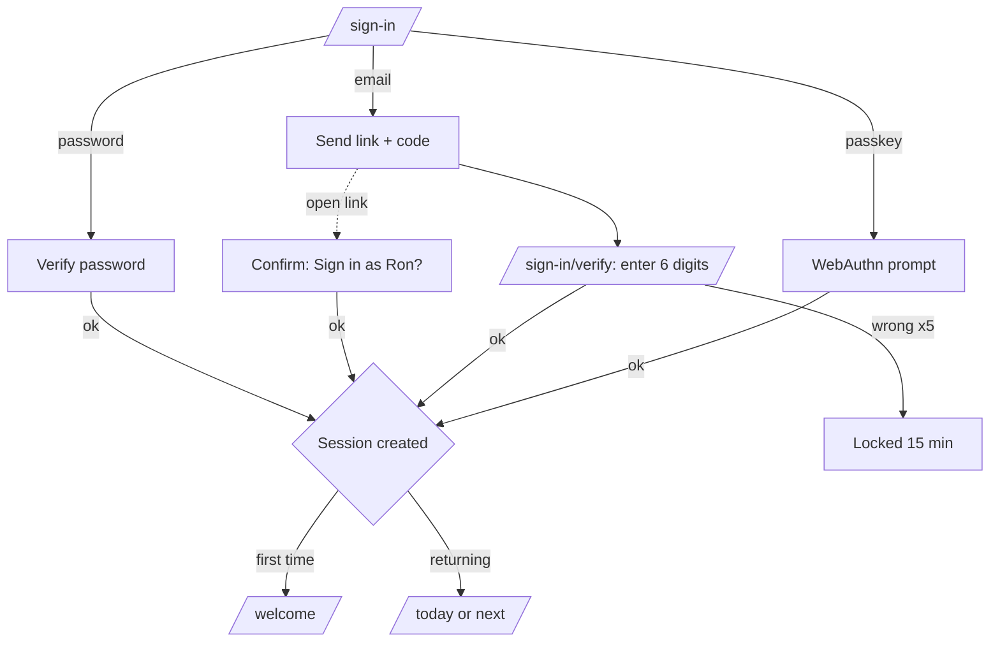

---

## Flow 2 — First-run onboarding (`/welcome`)

**Trigger:** first sign-in. **Rule:** a progress bar and "Step n of 5" show on every step (W §5 a12). Every step saves on "Continue" so the member can leave and resume. Every step except step 1 has "Skip for now".
**Layout:** single column, 640 px max, `Progress` bar at the top, `Back` ghost button, sticky footer with primary "Continue" (W §4 r11).

| # | Step | Screen / state | Member does | System does |
|---|---|---|---|---|
| 1 | **Home club** | Heading "Where do you train most?" Five `ClubCard` (compact) as a radio group, grouped MESA and GILBERT. Each shows photo, name, personality line, BusynessMeter. Pre-selected from the join. | Picks a club. | Saves `homeClubId`, `viewingClub`. Trailhead: text "Trailhead books at one club. You can change it once per billing cycle" [P12 note]. |
| 2 | **Interests** | "What do you like?" 8 `CategoryBadge` toggle chips (icon + name). `Switch` "Show first-timer classes first". | Picks 0–8. | Saves `interests[]`. Used to rank suggestions on Today. |
| 3 | **Goals** | "What are you aiming for?" Radio cards: Build strength · Move more · Train for an event · Stay consistent · Recover well. Then "Visits per week" `ToggleGroup` 1–7 (default 3). Help text "Rest days count too." | Picks one goal and a number. | Saves `goal`, `weeklyTarget`. Feeds ProgressRibs (5 ribs = 100 % of the monthly target). |
| 4 | **Notifications** | Table of topics × channels (Push, Email, Text) using `Switch`. Topics: Class reminders (60 min before), Waitlist and held spots, Booking changes, Club news, Billing (email always on), Coach messages. Marketing off by default. | Turns channels on or off. Turning on Push shows an explainer, then the browser permission prompt. | Saves preferences. Asks browser permission only after the member turns Push on. If denied: row shows "Push is blocked in this browser. Use email or text." |
| 5 | **Pass and calendar** | Preview of CheckInPass. Two cards: "Add your bookings to your calendar" (shows ICS URL, "Copy link", "Open in Google Calendar", "Open in Apple Calendar") and "Add a passkey". | Optional. | Creates calendar token. |
| Done | Redirect to `/today` | Toast "You're set. Here's your first week." Today shows 3 suggested classes at the home club that match interests and carry the "Good for first-timers" flag (F §3). | — | — |

**Decisions and errors**
- Member leaves at step 3: next sign-in opens `/welcome?step=3` with a banner on Today "Finish setting up (2 steps left)".
- Browser blocks push: row shows the reason and does not retry.
- Teen: step 4 shows "Alicia also gets booking alerts" (parent copy). No marketing options.
- Family adult: step 1 pre-selected as the household home club.
- Child: no onboarding (no login).

**Confirmation / undo:** each step has Back. Everything is editable later in Settings.

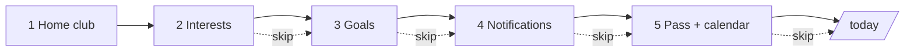

---

## Flow 3 — Book a class

**Personas:** Priya (P1), Maya (M1), Daniel (D1). **Entry:** `/schedule`, Today suggestions, ⌘K, club page, email link.

| # | Screen / state | Member does | System does |
|---|---|---|---|
| 1 | `/schedule` (list or week). Skeleton rows with status text "Checking availability…" (W §4 r7; W §5 a1). | Picks day with ScheduleDayStrip (Today, Tomorrow, Thu 29, Fri 30, Sat 31, Choose date) (W §4 r4). Optionally sets filters. | Fetches sessions for the viewing club and the week. Opens a live channel (SSE) for spots left. |
| 2 | Each row is a `ClassCard` `schedule-row` in the shared reading order: time (bold) with duration under it, title (with category badge and ribs under it), instructor, spots left, `BookingStateButton` (mobbin-standard-pass §2 rules 61, 24; W §4 r2–r3). | Clicks the row (not the button) to see details. | Intercepted route opens `ClassDetailPanel` (variant `sheet`, Graphical `Drawer`, 480 px) at `/schedule/[sessionId]`. Focus moves to the panel title. |
| 3 | Panel: ClassDetailPanel. Sticky bottom action bar with BookingStateButton large (W §4 r11; W §5 a5). Shows `BookingForSelect` if the household has other members. | Chooses who it is for. | Re-checks eligibility for that person (age, plan, strikes). |
| 4 | Conflict check | Presses "Book". | If the member already has a booking that overlaps, shows **conflict dialog**: "You're booked for Desert Flow Yoga at 6:30 a.m. This class starts at 6:00 a.m. and ends at 6:45 a.m. Replace it?" Buttons: "Keep Yoga" (left) and "Book Climb Cycle instead" (right). Replace cancels the first with no strike if it was more than 2 hours away. |
| 5 | `pending`: button "Booking…". Spots left drops by 1 optimistically. | — | POST with an idempotency key. |
| 6 | `booked`: the panel shows the shared **confirmed view** (shared §7.2; mobbin-standard-pass §2 rules 44–46, 62): one green check, headline "You're booked", green "Confirmed" pill, summary card (date, time, club, studio, instructor, "Bike 14", reference "CP-9D3M1", W §4 r36), filled "Add to calendar", "Share" text link, four action rows (Add to calendar, Get directions, Call the club, Club details) and "Done". The sticky bar then reads "Booked" with a grey "Cancel" (rule 40). Toast: "Booked: Climb Cycle, Tue 6:00 a.m." with "Undo" (10 s). | Closes panel or keeps going. | Sends confirmation email (no push). Schedules reminder 60 min before (push/email per prefs). Adds to `/bookings`. |
| 7 | Row in schedule updates to `booked` (success chip + check icon). | — | — |

**Decisions**
- Window: if the class is beyond 7 days (Summit 9), `restricted` with the reason "Opens Wed, Oct 28 at 6:00 a.m.". Countdown replaces the label when under 60 minutes: "Opens in 00:20". At zero the state flips to `book` with no reload. Server time is the clock.
- Class at another club on Trailhead: `restricted` ("Ridge only").
- Under-age, age-rule or teen-blocked: `restricted`, shown in step 3.
- Full: `waitlist` → Flow 4. Full with the waitlist closed: `full`.
- Booking pause: `paused`.

**Errors and edge cases**
| Case | Result | Copy |
|---|---|---|
| Spot taken while booking (409 `CLASS_FULL`) | Button flips to `waitlist`; spots left corrects; optimistic change rolls back | "That class is full. Join the waitlist or pick the 7:00 a.m. class." with a "7:00 a.m. Climb Cycle" quick link when one exists |
| Network error | Rolls back | "We couldn't reach the server, so your booking wasn't made. Try again." + "Try again" |
| Class changed (time/instructor) while panel open | Banner in panel | "This class changed. Now 6:15 a.m. with Devon Hart. Review before you book." |
| Window closed / paused / plan | State change, no error toast | See states table |
| Class started | `started` | "Class has started." |
| Double click | Idempotency key returns the same booking | — |
| Booked in 2 tabs | Second tab receives SSE update and shows `booked` | — |
| Session cancelled by club | Notification + booking removed, no strike | "Climb Cycle on Thu was cancelled. You were not charged a strike." |

**Confirmation and undo:** Undo toast for 10 seconds cancels with no strike and no 2-hour rule. After that, use Cancel (Flow 5).

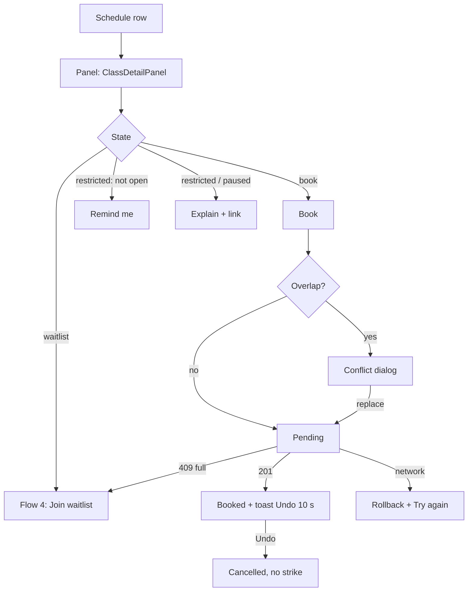

---

## Flow 4 — Join waitlist, promotion and 30-minute hold

**Rules (F §4 "Rules settled"):** up to 5 active waitlists per member. When a spot opens, the first person gets a push and holds the spot for 30 minutes. They must tap **"Confirm spot"** in that time, or the spot goes to the next person. Promotions stop 1 hour before start. Inside that hour, open spots show as drop-in spots. Lap lanes have no waitlist. Kids club blocks do.
**Research:** a waitlist screen exists (Fresha; mobbin-standard-pass §3 correction 5; §2 rule 47). Pattern: explicit dialog, notice with "Book now", sticky full-width button, consent checkbox that states the late-cancel rule (G r1–r4). Component: shared `BookingStateButton` waitlist dialog (shared §8.1).

### 4A — Join
| # | Screen / state | Member does | System does |
|---|---|---|---|
| 1 | State `waitlist`. Button "Join waitlist". Line "Full. 3 people waiting." | Presses Join waitlist. | Opens the **waitlist dialog** (Graphical `Dialog`; bottom `Drawer` under 768 px). |
| 2 | Dialog, shared text: title "Join the waitlist for Rib Rack Strength". Body: "You are 4th in line. If a spot opens, we hold it for you. You get a push and 30 minutes to confirm. We stop moving people up 1 hour before class (5:00 a.m.). Late cancels count as strikes." One `Checkbox`, **shown every time and unticked**: "I understand the late-cancel rule." Primary "Join waitlist" is **disabled until the box is ticked** (mobbin-standard-pass §2 rule 47). Text link "Pick another class". "Notify me by: Push, Email" with "Change". If a spot opens while the dialog is open: notice "A spot just opened. Book now" (G r2). | Ticks the box. Presses Join waitlist. | Adds the member. Position = count + 1. Checks the limit of 5 (`LIMIT_REACHED`). |
| 3 | State `waitlisted`: "On waitlist #4". Menu: Leave waitlist. Hint: "We stop moving people up 1 hour before class." | — | Position updates live. Entry shows in `/bookings` > Waitlist. |

### 4B — Promotion and hold
| # | State | System does | Member sees |
|---|---|---|---|
| 5 | A spot opens (cancel or capacity change) more than 1 hour before start. | Gives the spot to the first eligible person and starts a 30-minute hold. Skips anyone with an overlapping booking, a booking pause, or no plan access (and tells them: "We skipped your waitlist spot for Rib Rack Strength: you're booked at that time."). | Push, in-app and email: "A spot opened in Rib Rack Strength, Thu 6:00 a.m. It's yours for 30 minutes." `WaitlistBanner` on every page. `BookingStateButton` state `hold`: **"Confirm spot · 28:41"**. |
| 6 | Member presses **Confirm spot**. | Converts to `booked`. If start is under 2 hours away, the confirmation says: "You're booked. Cancelling now counts as a late cancel." (`late-cancel` state.) | Toast + shared confirmed view. |
| 7 | Member presses **Release**, or 30 minutes pass. | Releases the spot to the next person. **No strike.** | Toast "Released. You're off the waitlist for this class." After expiry: "Your hold ended. We offered the spot to the next person." |
| 8 | Start time minus 1 hour. | Promotions stop. | Notification to those still waiting: "The waitlist for Rib Rack Strength is closed. Spots show live, as drop-in spots." State `full` with the reason "Waitlist closed 1 hour before start" while the class is full. When a spot opens, state `book` with the line "Drop-in spot." |

**Edge cases**
- A hold issued at exactly 1 hour before start lasts the full 30 minutes.
- A member may leave the waitlist at any time at no cost.
- Two holds at once: the member is told about both. Confirming one removes the other overlapping hold.
- Capacity grows (room change): promotion runs for each new spot.
- The hold timer uses server time. `aria-live="polite"` announces at the start, at 5 minutes and at 1 minute (shared §8.1 Accessibility), not every second.
- Kids club blocks follow the same rule. Courts and lanes have no waitlist [P6]; the grid is live.
- "Release" is an app action next to the shared `hold` button. The shared spec does not define it. It does not change the `hold` state.

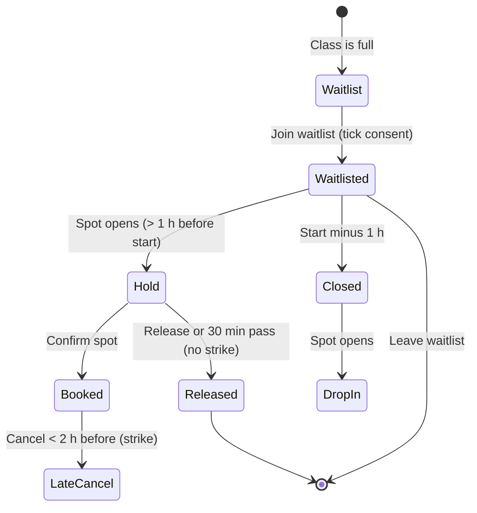

---

## Flow 5 — Cancel a booking (on time vs late cancel)

**Rules:** free up to 2 hours before start. Later = late cancel (a strike). 3 strikes in 30 days = 3-day booking pause (F §3). A no-show counts as a late cancel (F §4).
**Pattern (shared §7.2 cancel flow; supersedes the side-by-side layout in the first draft):** one stacked dialog with the consequence first. Buttons in this order: filled **"Keep my spot"**, outline **"Reschedule instead"** (only when other sessions of the same class exist this week), quiet danger text button **"Cancel booking"** at the bottom. Reasons are an optional radio list. Red X icon lines list what is lost, each in words too (mobbin-standard-pass §2 rules 26–28; G r18, r20, r21). On narrow screens the dialog is a bottom sheet with a bold question and the class name (rule 43).
**Entry:** `/bookings` row menu, panel "Cancel" (grey outline button in the sticky bar, rule 40), Today `NextUpCard`.

| # | Screen / state | Member does | System does |
|---|---|---|---|
| 1 | Presses **Cancel** or "Cancel booking". | | Compares now with start − 2 h. Branch A or B. |

### Branch A — more than 2 hours before start (on time)
| # | Screen / state | Member does | System does |
|---|---|---|---|
| A2 | `AlertDialog`. Title "Cancel your spot in Climb Cycle?" (class name and time in small caps under it). First line: "You can cancel for free until 4:00 a.m. You can rebook until it fills." Optional radio list "Why? (optional)": Schedule changed · Feeling unwell · Injury · Booked by mistake · Other (text box appears only for Other) (rule 26). Buttons stacked: filled **Keep my spot** · outline **Reschedule instead** · text **Cancel booking** (danger). | Picks a reason or skips. Confirms with Cancel booking. | Cancels. Frees the spot. Runs waitlist promotion. |
| A3 | Toast "Cancelled. Undo" (10 s). | May press Undo. | Undo re-books if the spot is still free. If taken: "That spot was taken. Join the waitlist?" |

### Branch B — less than 2 hours before start (late cancel) — `LateCancelDialog`
| # | Screen / state | Member does | System does |
|---|---|---|---|
| B2 | `AlertDialog`. Title "This is a late cancel". First line: "Cancelling now adds 1 late cancel to your account." Consequence lines, each with a red X icon **and** words (rule 28): "Counts as a strike (2 of 3 in 30 days)" · "Your spot goes to the next person on the waitlist" · "3 strikes in 30 days pause booking for 3 days". Strike indicator: 3 segments with the text "Strike 2 of 3". Clearing line: "This one clears on Nov 26." Buttons stacked: filled **Keep my spot** (initial focus) · outline **Reschedule instead** (if the class runs again this week; it does not remove the strike) · text **Cancel booking** (danger). No reason list. | Keeps or cancels. | Cancels. Adds strike (expires after 30 days). Promotes the waitlist if before start − 1 h. |
| B3 | If this is strike 3: extra X line "Booking pauses for 3 days, until Fri, Oct 30 at 9:12 a.m. You can still cancel and check in." The quiet button reads "Cancel and pause booking". | | Starts the pause [P3]. Global banner shows. |
| B4 | Toast "Cancelled. 2 late cancels in 30 days." No Undo (the spot may already be offered). | | Confirmation email with strike count. |

**Edge cases**
- Held spot released within the 30-minute hold: no strike (Flow 4).
- Booking made less than 10 seconds ago: Undo toast path, no strike.
- No-show: one late cancel [P2]. Email next morning: "You missed Climb Cycle. That counts as a late cancel."
- Club cancels the class: no strike.
- Frozen household: bookings inside the freeze are cancelled automatically, free.
- Strike disputes: "Think we got this wrong? Message the front desk" on `/bookings`.
- Court and lane: same dialog [P4]. Kids club: no strike. Dialog: "Cancel Theo and Ivy's kids club block? It's free. Please cancel at least 2 hours before so another family can use the spots."
- The destructive action is a quiet text button on purpose. It is still visible, in words, and one click away. That differs from G r19 (destructive on the right), which the shared spec replaced.

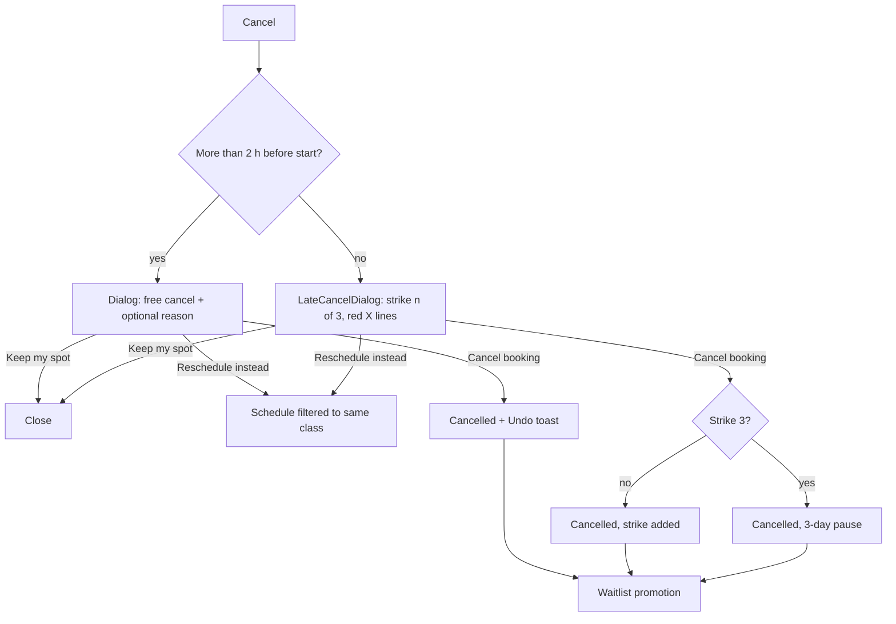

---

## Flow 6 — Reserve a court (players, invite partner)

**Personas:** Ron and Linda (R1, R4). **Rules:** 60- or 90-minute slots; book 3 days ahead (F §3); Ridge or Summit [F §4]; windows open 6:00 a.m. [P1]; checkout hold 5 min [P15]; one per day [P5]. Courts exist at Mesa – Dobson (4 pickleball, 2 tennis), Mesa – Red Mountain (6 pickleball), Gilbert – Val Vista (2 basketball, 4 pickleball) (F §2). Research: a sport-court grid with courts as columns was still not found (mobbin-standard-pass §1 search W6; shared §8.2 calls the matrix new). Nearest: Square availability rows by resource with green time-range blocks (rules 22–23), two-pane slot picker with green-dot free slots and AM/PM groups (W §4 r12–r14, r20; rule 25; G r22–r24). Component: shared `ReservationSlotGrid` `matrix` layout (shared §8.2).

| # | Screen / state | Member does | System does |
|---|---|---|---|
| 1 | `/reserve` hub → card "Reserve a court". If Trailhead: locked card "Courts come with Ridge and Summit. Compare plans." | Opens `/reserve/courts`. | Loads viewing club. If the club has no courts (Mesa – Downtown, Gilbert – Heritage): EmptyState "No courts at Mesa – Downtown. Mesa – Red Mountain has 6 pickleball courts." with ClubSwitcher shortcut. |
| 2 | **Setup bar**: Club (ClubSwitcher, only clubs with courts), Sport `ToggleGroup` (Pickleball · Tennis · Basketball, only those the club has), Court level/type `Select` with counts ("Pickleball · 6 courts") and "Done" (W §4 r20), Date (ScheduleDayStrip, next 4 days: Today to +3; days beyond 3 show "Opens Wed, Oct 28 at 6:00 a.m."), Duration `DurationChips` "60 min | 90 min" (segmented chips, selected chip filled; mobbin-standard-pass §2 rule 60). Time zone note under the strip: "Arizona time (no daylight saving)" (W §4 r15; G r23). | Picks Sat, Oct 31, Pickleball, 90 min. | Fetches grid. Status "Checking availability…". |
| 3 | **Court grid** (ReservationSlotGrid, court variant): rows = courts (Court 1–6), columns = start times in 30-minute steps grouped under "AM" and "PM" headers (W §4 r13). Slot statuses are the shared ones: `open` (green dot, outline, time; W §4 r14), `selected` (Saguaro `secondary` fill with check), `mine` ("Yours", `primary-subtle`), `taken` (hatch + lock), `closed` (hatch + "Closed"), `past`. App-only addition: a `short` look for "not enough time" (dim, no dot; tooltip "Needs 90 minutes. Court 2 is taken at 9:30 a.m."). Legend under the grid. | Selects Court 3 at 8:00 a.m. | Highlights a 90-minute bar from 8:00 to 9:30 a.m. Sticky bar (W §4 r11): "Pickleball · Court 3 · Sat, Oct 31 · 8:00–9:30 a.m. · Mesa – Red Mountain" + "Continue". Starts the 5-minute slot hold at step 5 (the sticky bar button names the choice: "Reserve Court 3" at step 5). |
| 4 | **Players**: stepper "How many players?" 2–4 for pickleball and tennis, 2–10 for basketball (W §4 r42). Row per extra player: `Combobox` "Search members" (household first: "Linda Park"), or "Invite by email or phone (guest)". Guest rows show "Uses 1 guest pass. You have 1 left." or "Costs $20 per guest." | Sets 4 players: Linda (member), Pat (member), Guest. | Validates each: member = invite; guest = needs guest pass (Flow 10). |
| 5 | **Review**: summary card, reference code shown after confirm, cancel rule line "Free to cancel until 6:00 a.m. (2 hours before)." Countdown "We're holding this court for 4:32." At 1:00 left: alert "1 minute left. Add 5 minutes?" with button (once). | Presses "Reserve court". | POST. Creates reservation. Sends invites. |
| 6 | `/reserve/confirmed/[reservationId]`: the shared success pattern (rules 45, 46, 62): one green check, headline "Court 3 is yours", "Confirmed" pill, summary card with booking reference "CP-7K2F4" (W §4 r36) and the players list with status chips (Confirmed, Invited, Guest pass sent). Filled "Add to calendar", "Share" text link that copies the invite link (W §4 r17), action rows (Get directions, Call the club, Club details), "Done". "Cancel reservation" is a quiet link in the summary card. | | Calendar entry for owner now; for invitees on accept. |

**Invitee flow:** a member receives notification "Linda invited you to pickleball, Sat 8:00 a.m., Red Mountain, Court 3." with **Accept** / **Can't make it**. Accept adds the event to their calendar. Playing as an invitee does not count toward their own one-court-per-day limit. Decline notifies the owner. If all invitees decline, owner gets "Everyone passed. Keep Court 3 or cancel?".

**Edge cases and errors**
| Case | Copy / result |
|---|---|
| Slot taken during checkout (409) | Grid refreshes, selection clears. Toast "Court 3 was just booked. Pick another time." |
| Already have a court that day [P5] | "You already have a court on Sat, Oct 31. You can have one per day." + link to the reservation |
| Date not yet open | "Saturday courts open Wed, Oct 28 at 6:00 a.m." + "Remind me" |
| Guest has no pass | Inline "Add a guest pass ($20)" opens Flow 10 in a dialog and returns to step 4 |
| Hold ends | Dialog "Your hold ended. The court is open to others. Pick it again?" with "Pick again" button |
| Club closes before the end | End time past close is disabled |
| Move a reservation | `Move` action opens the grid with a row "Original selection: Sat, Oct 31, 8:00–9:30 a.m." (W §3.3 GetYourGuide reschedule). Free until 2 hours before |
| Teen | Sees only invitations unless parent allows courts [P8] |

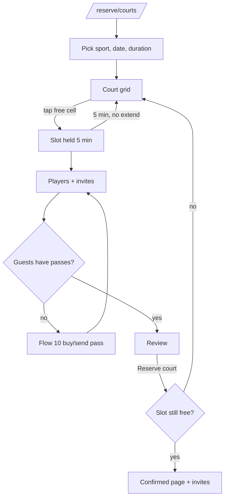

---

## Flow 7 — Reserve a lap lane

**Rules:** 45-minute slots (F §3). Pools close 30 min before the club (F §2). Lap pools: Mesa – Dobson (25-yd, 8 lanes), Mesa – Red Mountain (outdoor 25-m, 8 lanes), Gilbert – Val Vista (25-yd, 6 lanes) (F §2, F §4). The slot shows "1 of 2 swimmers". Slots tile from opening time: weekday 4:30 a.m., 5:15, 6:00, 6:45 …; weekend from 6:00 a.m. A lane slot holds up to 2 swimmers [P6]. No waitlist [P6].

| # | Screen / state | Member does | System does |
|---|---|---|---|
| 1 | `/reserve/lanes`. Setup bar: Club (pool clubs only), Date strip (classes window), time-of-day anchors (Early · Morning · Midday · Evening). | Picks Mesa – Dobson, Wed, Oct 28. | Loads grid. |
| 2 | **Lane grid**: rows = Lane 1–8 (1–6 at Gilbert – Val Vista); columns = 45-minute slots; each cell shows 2 small dots (filled = taken) and, on a shared lane, the text "1 of 2 swimmers". Cell statuses are the shared ones (shared §8.2). Top button row: **Any lane** (default, selects the best-matching lane). | Clicks the 6:00 a.m. column header ("Any lane") or a specific cell. | Highlights the cell. Sticky bar: "Lane 3 · Wed, Oct 28 · 6:00–6:45 a.m. · Mesa – Dobson · 1 swimmer" + "Reserve lane". |
| 3 | Optional: "Add a lane partner" (member search). | | A partner uses the 2nd place. |
| 4 | Confirm. | Presses "Reserve lane". | Creates reservation. Toast "Lane 3 is yours, Wed 6:00 a.m. Undo". The shared success pattern, inline (not a full page): green check, "Lane 3 is yours", summary card, filled "Add to calendar", "Share" link, "Done". |

**Edge cases:** all lanes full → EmptyState "All 8 lanes are taken at 6:00 a.m. Try 6:45 a.m.", with the two nearest free slots as buttons. Pool closed (last slot ends before close − 30 min) → cells show "Closed". Club has no pool → EmptyState with ClubSwitcher. Cancel: same as Flow 5 [P4]. Warm-water therapy pool: not reservable here; link "See Aqua classes".

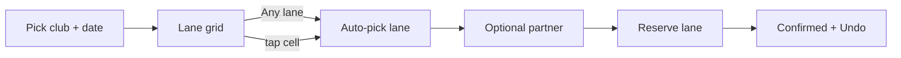

---

## Flow 8 — Book kids club blocks

**Persona:** Maya (M2). **Rules:** 2-hour blocks; check-in by parent; hours Mon–Sat 8:00 a.m.–12:00 p.m. and 4:00–8:00 p.m. (F §2–3). Kids club exists at Mesa – Dobson, Mesa – Red Mountain, Gilbert – Val Vista. Ages **6 months–12 years**, parent checks in at the same club, max 2 blocks per child per day, an unclaimed block is released 15 minutes after start [P7]. Research: no kids-club check-in flow in Mobbin (still a gap after mobbin-standard-pass). Nearest: household list with "Add" link (W §4 r41) and block tiles. Component: shared `ReservationSlotGrid` `blocks` layout (shared §8.2).

| # | Screen / state | Member does | System does |
|---|---|---|---|
| 1 | `/reserve/kids-club`. Step bar "1 Club · 2 Children · 3 Day and block · 4 Review". Club list shows the three clubs with kids club; the other two are disabled with "No kids club here". | Picks Gilbert – Val Vista. | Saves choice. |
| 2 | **Children**: `CheckboxGroup` of household children with photo, name, age. Theo (9) and Ivy (6) eligible. Chris and teens do not appear. A child with missing info shows "Add allergy notes first" and a link. | Ticks Theo and Ivy. | Validates profile completeness. |
| 3 | **Day and block**: `ScheduleDayStrip` (Mon–Sat only; Sunday disabled, shown muted with the note "Closed Sundays"). `blocks` layout, four tiles: 8:00–10:00 a.m., 10:00 a.m.–12:00 p.m., 4:00–6:00 p.m., 6:00–8:00 p.m. Each tile shows spots left ("6 spots left"; the `low` look with a warning triangle under 3). Needs 2 here. Select 1 or 2 blocks. | Picks Sat, Oct 31, 8:00–10:00 a.m. | Checks spots for 2 children. |
| 4 | **Review**: per child line, authorised pick-up adults (default Maya, Chris; "Change" link), `Checkbox` "Allergy and medical notes are up to date", text "You check in at Gilbert – Val Vista before drop-off and stay in the club." Free to cancel until 6:00 a.m. | Presses "Book kids club". | Creates 2 bookings in one action. |
| 5 | **Confirmation** (shared success pattern, inline): green check, "Theo and Ivy are booked", "Confirmed" pill, summary card, filled "Add to calendar", "Share" link, row "Show passes" (opens `/pass` for each child), "Done". | | Email to Maya and Chris. |

**Edge cases**
- Not enough spots for both: tile shows "1 spot left. Need 2." Options: "Book Theo only", "Join waitlist" for both (same waitlist rules as classes: consent box, 30-minute hold, "Confirm spot") [P7, P14].
- A child younger than 3 can be added for kids club only. No add-on price is shown until the foundation states one (section 9 of file 01).
- Child has a class at the same time (e.g. Swim School): conflict dialog as in Flow 3.
- Block already past: disabled.
- Child is 13 or older: not listed (kids club ends at 12); message "Jordan, 14, can book Teen Strength instead."
- Booking window follows the class window (7/9 days) [P7].
- Cancel: free; copy in Flow 5. No strikes.
- Parent checks in late: Kids club desk sees "Parent not checked in"; block can be released after 15 minutes [P7]. (Staff-side; the member sees only a notification: "Please check in at the club so Theo can join.")

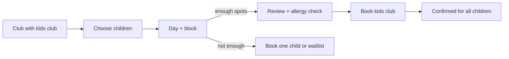

---

## Flow 9 — Book personal training (coach pick, pack purchase)

**Personas:** Daniel (D4). **Rules:** packs of 4/8/12 sessions (F §4); prices and policies [P10]. Summit gets 1 PT intro session per quarter (F §4). Pattern: Calendly/Skillshare two-pane picker (W §4 r12; G §8, r22–r24). PT booking is not a Mobbin flow; nearest are Calendly (rule 25) and the staff avatar choice with a ring on the selected person and Square availability ranges like "Available 8 am – 8 pm" (mobbin-standard-pass §2 rules 23, 37). Component: shared `ReservationSlotGrid` `list` layout with a coach picker (shared §8.2).

| # | Screen / state | Member does | System does |
|---|---|---|---|
| 1 | `/training`. `CoachCard` (variant `card`) grid with filter chips by specialty (Return to training, Strength, Olympic lifting, Swim, Mobility, Youth) and by club. A "Match me to a coach" button (3 questions). | Filters "Return to training". Opens Sam Okafor. | Shows coach profile `/training/coaches/sam-okafor`. |
| 2 | Coach profile: photo, specialties, clubs, bio, "Good for first sessions" tags, next 3 open times. Primary "Book a session". | Presses it. | Opens `/training/coaches/sam-okafor/book`. |
| 3 | **Two-pane picker** (desktop). Left: coach picker (`InstructorChip` `choice`: round photos, ring and check on the selected coach, availability range in `success` text such as "Available 8 a.m.–8 p.m."), "45-minute session", "45-minute session", club `Select` (Sam's clubs), price lines. Right: month `Calendar` with dot under days that have openings (G r22), then time list in vertical outlined tiles with green dot, grouped AM / PM (W §4 r13, r14), time zone line under the calendar "Arizona time (no daylight saving)" (G r23). Below 1024 px the panes stack. | Picks Thu, Nov 5 and 10:15 a.m. | Holds the slot 5 minutes (same checkout hold as courts; app decision, see file 01 §9). |
| 4 | **How do you want to pay?** Radio cards: *Use a pack credit* (only if credits exist, "4 left in your 8-pack"), *Summit intro session* (free, only Summit, shows "1 left this quarter"), *Single session: $75*, *Buy a pack*. Buy a pack opens three cards: 4 sessions $276 ($69 each) · 8 sessions $520 ($65 each) · 12 sessions $732 ($61 each). The 8-pack carries a "Most chosen" tag only if data supports it. | Chooses "Buy a pack: 8 sessions". | Computes total. |
| 5 | **Notes for your coach** (optional `textarea`, 500 chars): "Anything Sam should know? Injuries, goals, what to avoid." Privacy line: "Only Sam and club staff see this." | Types "Right knee, surgery in June. No deep squats yet." | Saves to the thread. |
| 6 | **Review**: summary card + payment method (PaymentMethodCard compact, "Change") + total "Today's total: $520.00" (W §4 r23) + cancel rule "Free to cancel or move until 24 hours before." | Presses "Book session and buy pack". | Charges card. If 3-D Secure is needed, shows the bank step in a dialog. |
| 7 | **Confirmation** (shared success pattern): green check, "You're booked with Sam", "Confirmed" pill, summary card with "8-pack: 7 left", filled "Add to calendar", "Share" link, row "Message Sam", "Done". | | Creates inbox thread; sends email. |

**Edge cases**
- Payment fails: stay on step 6; error "Your card was declined. Try another card or call your bank." Slot hold continues for the remaining time.
- Slot taken: "That time was just booked. Pick another time."
- Coach cancels: sessions return as credits; notification "Sam can't make Thu 10:15 a.m. Your credit is back. Pick a new time."
- Reschedule: `Move session` shows "Original selection" (W §3.3). Free until 24 hours before; late = session used.
- Teen: picker works, but step 6 says "Alicia needs to approve this." and sends a request (Flow 19).
- Frozen: PT credits remain; sessions in the freeze are cancelled and returned.
- No coach has openings in 14 days: EmptyState "No open times with Sam in the next 14 days. Try Elena, or message the front desk."

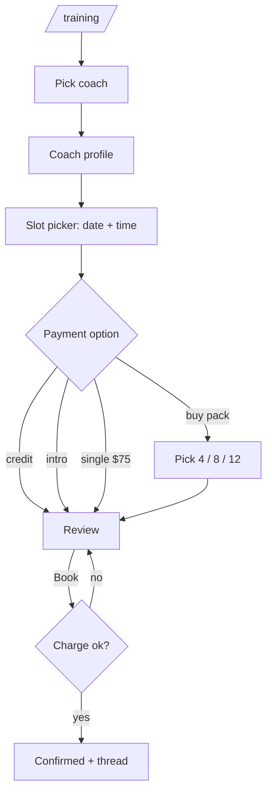

---

## Flow 10 — Buy or send a guest pass

**Persona:** Maya, Ron and Linda. **Rules:** Ridge 1 per month, Summit 4 per month, Trailhead 0; day pass $20, one visit, one club (F §4). Details [P9]. Pattern: share link after booking with guests (W §4 r17); a link field with "Copy link" and a list of pending invites (mobbin-standard-pass §2 rule 36; search W9: Cofounder, Replit, Airtable); one success pattern (rules 45, 62).

| # | Screen / state | Member does | System does |
|---|---|---|---|
| 1 | `/guest-passes`. Balance card: "1 of 1 left. Resets Nov 12." Button "Send a guest pass". List below: Sent, Opened, Used, Expired. | Presses Send. | Opens dialog `/guest-passes/send`. |
| 2 | **Guest details**: Name, Email or mobile (one), Club (default viewing club), Visit date (within 14 days), checkbox "My guest is 16 or 17" (shows "A parent or guardian signs a waiver"), optional message (200 chars). Stepper "How many guests?" 1–4 when buying (W §4 r42). | Fills. | Checks that the contact is not a current member: "Pat Reyes is already a member. They don't need a pass." |
| 3 | **Cost line**: "Uses 1 of 1 included passes." or, if none left, "Costs $20 per guest. Charged to Visa ending 4821." Button label changes: "Send guest pass" or "Pay $20 and send". | Presses it. | Creates pass(es). Sends email/text with link. |
| 4 | **Done** (shared success pattern, adapted: the filled button is "Copy link" instead of "Add to calendar"): green check, "Pass sent to Pat", "Sent" pill, summary card (valid until Nov 10), link field with **Copy link** (rule 36), "Send another" text link, "Done". The pass then appears under "Sent" with a "Pending invites"-style status. | | Guest opens link: sees waiver, QR, club hours, parking. Status Opened → Used when scanned. |

**Edge cases**
- Balance 0 and Trailhead: primary button is "Buy a guest pass: $20"; no apology copy.
- Guest never used it: expires after 14 days; included pass is **not** returned after expiry [P9]; revoke before expiry returns it.
- Revoke: menu on a Sent pass → "Cancel pass" dialog "Pat won't be able to use this link. We'll return the pass to your balance." (bought pass: refund $20).
- Wrong address: "Edit contact" while status is Sent.
- Payment fails: error in dialog; pass not sent.
- Frozen membership: sending disabled "Guest passes pause while frozen."
- Teen: no access (hidden).
- Court guests (Flow 6) use the same pool.

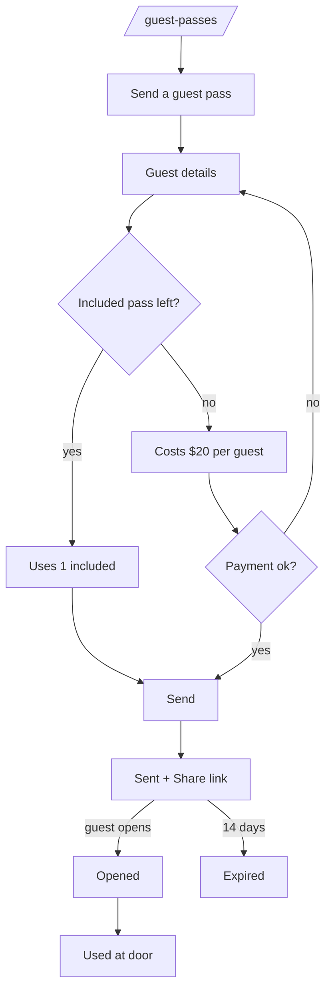

---

## Flow 11 — Add a family member

**Persona:** Maya (M7). **Prices:** +$39 per adult, +$19 per child (6 months–17; foundation §4); same access as the main plan; kids club included for children (F §4). Pattern: household sections with an "Add" link on each header (W §4 r41; W §3 Care.com), relationship radio before send (W §4 r39), role choices that each carry one line of help text (mobbin-standard-pass §2 rule 35), a grey "+" circle for "Add member" in the avatar row (rule 50), "Invite pending" with a "Send a reminder?" link (rule 51), guest-or-member split (W §4 r33), success with a next step (W §3.9 Basecamp).

| # | Screen / state | Member does | System does |
|---|---|---|---|
| 1 | `/family`. Sections: **Adults**, **Children and teens**. Each header has "Add" link. Rows show name, role label (Primary, Adult, Teen, Child), age, status pill (Active, Invited). | Presses "Add" next to Children and teens. | Opens `/family/add` as a wizard in a `Dialog` (page below 768). Progress bar "Step 1 of 5". |
| 2 | **Who are you adding?** `RadioGroup` of cards, each with one line of help (rule 35): "Another adult (18+) · +$39 per month — Gets their own login and pass." · "A child or teen (6 months–17) · +$19 per month — Kids club is included. Teens get a login." · "A child under 3 for kids club — Ask the front desk for the price." · "Just visiting? Send a guest pass instead" (link out to Flow 10). | Picks child or teen. | Saves. |
| 3 | **Details**: First/last name, date of birth (`autocomplete="bday"`), photo (optional now; required before first check-in), email (required for 13+, hidden under 13), emergency contact (prefilled with the primary member; WCAG 3.3.7), medical and allergy notes (`textarea`, children). | Adds Noah, born Mar 2015 (11). | Derives role from age: under 13 Child, 13–17 Teen, 18+ Adult. If age is outside 3–17 for this choice: inline message "Noah is 11, so he joins as a child. Adults are 18 and over." |
| 4 | **Permissions** (teen only): `Switch` Classes (on), Court reservations (off), Lap lanes (off, 14+), "Teen can message coaches" (on). Child: "Authorised pick-up adults" checklist. | Sets. | Saves [P8]. |
| 5 | **Waiver and review**: guardian e-signature for minors. Price card (W §4 r23): "Adds $19 per month. Charged today: $9.81 (16 of 31 days). From Nov 12: $175 per month." Payment method line. | Signs. Presses "Add Noah". | Creates the member, charges the prorated amount. |
| 6 | **Done**: green check, "Noah is on your plan", card with next steps. Primary "Set up Noah's pass" (adds photo), secondary "Not now" (W §3.9 Basecamp pattern: one primary, one deferral). For an adult: "Invitation emailed to chris@example.com" with "Resend". | | Child: pass is ready. Adult/Teen: invite email with link. |

**Edge cases**
- Adult invite not accepted in 14 days: pill "Invite expired", "Resend invite".
- Remove a member: confirm dialog "Remove Noah? His access ends Nov 12. His bookings after that date are cancelled. No refund for this month." [P12]. Primary member can undo until Nov 12 from the same row.
- Pending invites show "Invite pending" and a link "Send a reminder?" (rule 51); the avatar row ends with a grey "+" circle "Add member" (rule 50).
- Teen turns 18: email 30 days before "Jordan turns 18 on Dec 3. From Dec 12 the add-on is $39 per month. Jordan gets own billing choices." [P12 note]. Child turns 13: gains optional login.
- Payment fails at step 5: stay; error banner.
- Mid-freeze: adding is disabled "Resume your membership to add people."
- Household changes always email the primary member.

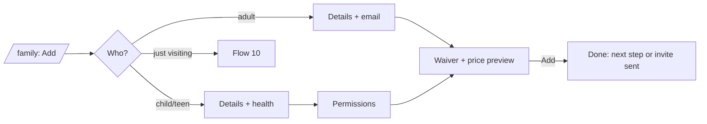

---

## Flow 12 — Change plan (proration preview)

**Persona:** Daniel (D5); Maya example below. **Rules** [P12]: upgrade now, prorated; downgrade next billing date. Pattern: shared `PlanCard` `current` and `change` variants (shared §9.1): current plan badge with disabled "Your plan" button (W §4 r21), feature matrix (W §4 r24), a "Before you switch" list of fee changes, lost features and ended items, each with a red X and words (mobbin-standard-pass §2 rule 31), a payment summary with Subtotal and "Today's total" and a note on when the new charge starts (rule 32; W §4 r23), and the change buttons: outline "Keep Ridge" on the left, filled "Switch to {plan}" on the right (G r5–r7). No monthly/annual toggle: the plans are month to month only (F §4), so rule W §4 r22 does not apply.

| # | Screen / state | Member does | System does |
|---|---|---|---|
| 1 | `/membership` → "Change plan". | | `/membership/change-plan`. |
| 2 | **Compare**: PlanComparisonTable (3 columns, rows = features) + PlanCard summary row. Current plan header shows "Current plan" badge and a disabled button (W §4 r21). Each other column has a button "Choose Summit" / "Choose Trailhead" that fills the preview. | Chooses Summit. | Computes preview. |
| 3a | **Upgrade preview** (`PlanChangePreview`): "Summit · $129 per month". Lines: "Plan difference $50 per month", "Prorated for Oct 27 to Nov 11 (16 of 31 days): $25.81", **"Today's total: $25.81"**, "Next charge: Nov 12 · $206.00 per month (Summit $129 + adult $39 + 2 children $19 each)". "Starts today. Everyone in your household gets Summit access." "Before you switch" lists only changes. Upgrade: "Nothing ends. You gain the recovery suite, 9-day booking and 4 guest passes per month." Buttons: outline "Keep Ridge" (left) and filled "Switch to Summit" (right). | Presses Switch to Summit. | Charges $25.81 to Visa ending 4821. |
| 3b | **Downgrade preview** (Ridge → Trailhead): "Starts Nov 12. You keep Ridge until then." "You'll lose: other clubs, courts, 1 guest pass per month." "Choose your home club" `Select` (required). Affected bookings table: "3 bookings after Nov 12 at other clubs and 1 court reservation will be cancelled with no late-cancel strike." "Next charge: Nov 12 · $54.00 + add-ons $77.00 = $131.00 per month". "Before you switch" lists the losses with red X icons and words. Buttons: outline "Keep Ridge" (left) and filled "Switch to Trailhead" (right), the same order as an upgrade (shared `PlanCard` `change`). | Picks club. Confirms. | Schedules the change. Status pill "Changing to Trailhead on Nov 12". |
| 4 | **Done**: green check page. "You're on Summit." Next-charge line (G r7). Link "See what's new": recovery suite, 9-day booking. Receipt emailed. | | Booking window changes to 9 days now. |

**Edge cases**
- Upgrade payment fails: stay on preview; "Your card was declined. Update your card, then try again." with PaymentMethodCard inline.
- Pending change can be cancelled until the effective date: pill "Changing to Trailhead on Nov 12" + "Undo change".
- Plan change while frozen: disabled "Resume first."
- Plan change within 1 day of billing: proration shows small numbers; still shown.
- Upgrade for a Trailhead household with kids club bookings elsewhere: no issue.
- Booking window grows: toast "You can now book 9 days ahead."
- Family adult: sees read-only plan, cannot change.

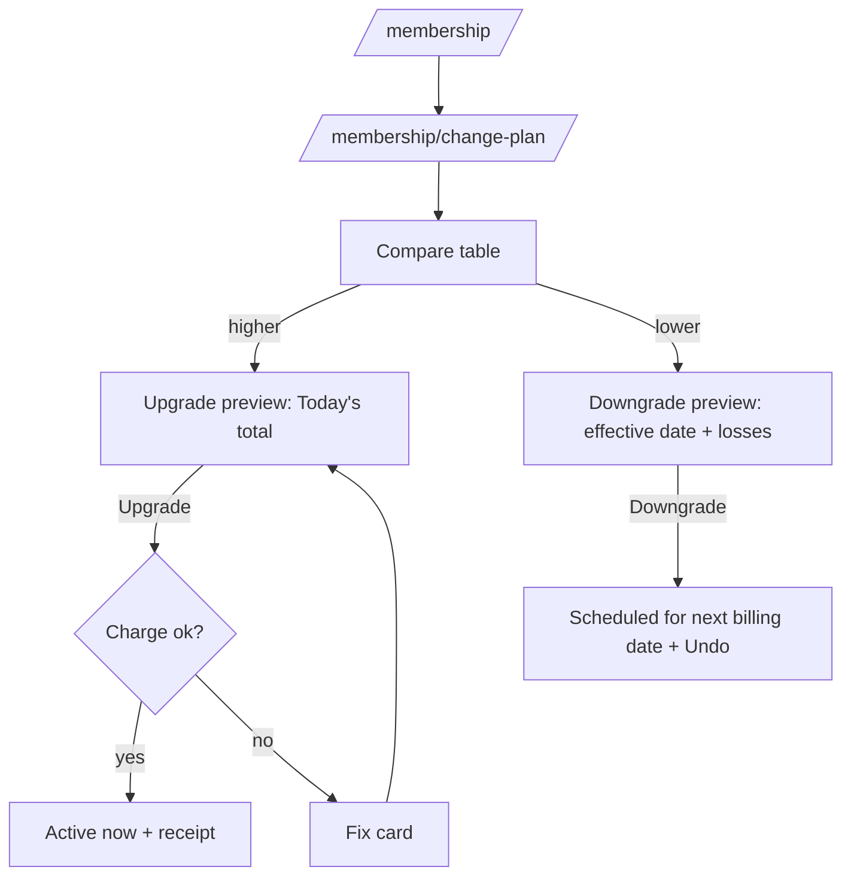

---

## Flow 13 — Freeze membership (1–3 months, $10 per month)

**Persona:** Maya (M6). **Rules:** freeze $10/mo, 1–3 months; 30 days' notice (F §4). Details [P11]. Research: pause flows are now covered (mobbin-standard-pass §3 correction 3; search W3): a plain headline, a duration select, one filled button (rule 29); one sentence with the renewal date and the pause window above the button (rule 30); on narrow screens a bottom sheet with a bold question, a full-width primary button and a "Not now" text link (rule 48); a paused state pill (rule 49; the shared spec makes it neutral, not green). Earlier nearest patterns still apply: status pill with a second action (W §4 r25) and the two-button path with effective date and renewal line (G r5–r7).

`FreezeWizard`: 3 steps with progress bar. Entry: `/membership` → "Freeze membership" (a normal button in "Manage" card, not hidden).

| # | Screen / state | Member does | System does |
|---|---|---|---|
| 1 | **Length and start**. `ToggleGroup` 1 / 2 / 3 months. Start date `Select` listing billing dates at least 30 days away: **Dec 12**, Jan 12, Feb 12 … Text "We need 30 days' notice, so the earliest start is Dec 12." Live summary: "Frozen Dec 12 – Jan 11 · Resumes Jan 12 · You pay $10 per month while frozen." | Picks 1 month, Dec 12. | Calculates dates. |
| 2 | **What changes** (checklist-style list): Pass pauses (all 4 members). Bookings inside the freeze are cancelled with no late-cancel strike (list shows 0 or the actual bookings). Kids club, courts, lanes: same. Guest passes: pause. PT: sessions in the freeze are cancelled, credits returned, pack dates extended. Billing: "$10 on Dec 12, then $156.00 on Jan 12." Family: "Freeze applies to everyone on your plan." | Reads. Ticks nothing (no required checkbox). | |
| 3 | **Confirm**: payment method line and one summary sentence above the button (rule 30): "Your plan pauses Dec 12 and returns Jan 12 at $156.00 per month." Filled **"Freeze membership"** (full width) with a "Not now" text link under it (rule 48). Under 768 px this step is a bottom sheet with a pause icon and the bold question "Freeze your membership?". | Presses Freeze. | Schedules freeze. |
| 4 | **Done**: green check page, "Freeze set: Dec 12 – Jan 11". Neutral status pill "Freeze scheduled" (later "Frozen until Jan 11", pause icon; rule 49 and shared `PlanCard` `current`) appears on Membership and as a banner on Today (surface-muted). "Cancel freeze" link until Dec 12. | | Email confirmation and a reminder 7 days before. |

**During a freeze**
- Today shows a calm card: "Your membership is frozen until Jan 11. See you Jan 12." with "Resume early".
- Pass shows state "Frozen" (not scannable).
- **Resume early**: dialog "Resume today? You'll pay $X for the rest of this cycle. Your pass works right away." Formula (foundation: early resume bills the plan price for the rest of the cycle): X = household monthly price (plan and add-ons) × remaining days ÷ days in cycle (example: $156.00 × 16 ÷ 31 = $80.52) Button "Resume membership". Next billing date does not change [P11].
- Booking buttons show `frozen`.

**Edge cases**
- Freeze requested but a payment is failing: blocked, "Fix your payment first."
- Cancel scheduled freeze: one click, toast "Freeze cancelled. You're active as usual."
- Only one freeze at a time [P11].
- Member needs a start sooner than 30 days: message "Need to freeze sooner? Message the front desk" (support may waive; not promised in UI).
- Bookings list includes items beyond the freeze that stay.
- Cancel membership during a freeze: allowed; effective first billing date ≥ 30 days.

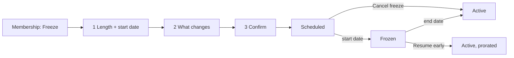

---

## Flow 14 — Cancel membership (retention without dark patterns)

**Rules:** cancel with 30 days' notice (F §4); effective first billing date at least 30 days away [P12]. Pattern: cancel inside a collapsed "Cancel membership" block with a clear label and stated consequence (W §4 r27; W §5 a4); consequence first (G r18); reason as optional radio (G r21; mobbin-standard-pass §2 rule 26); a list of what the member loses with a red X and words on each line (rule 28); two clear buttons (G r5). We **reject** the plain "Continue to cancel" / "Yes, cancel" text link used by Replit (rule 28) and Magnific (G §7), because it hides the action. The stacked cancel-booking dialog (Flow 5) uses a quiet text button for a booking; a membership is different: both choices are full buttons of equal size.

**Dark-pattern rules we apply (checked in QA):**
1. Cancel is reachable in 3 clicks from the sidebar: Membership → Cancel membership → Continue.
2. One retention step only, and the member can skip it.
3. Buttons "Keep my membership" and "Cancel membership" have equal size and are adjacent. No text-link-only cancel.
4. No guilt copy, no countdown, no confirm-shaming, no pre-ticked boxes, no required survey, no phone call.
5. Offers are real and shown with exact prices and dates.
6. The final screen states date of last access and last charge.
7. Reinstate with one click until the effective date.
8. Confirmation email arrives within 1 minute.

| # | Screen / state | Member does | System does |
|---|---|---|---|
| 1 | `/membership` bottom: collapsible "Cancel membership" (Graphical `Collapsible`, red title, closed by default). Text inside: "Cancel with 30 days' notice. You keep full access until your end date." Button "Cancel membership" (outline-danger). | Opens, presses the button. | Step-up auth if session > 30 min. Goes to `/membership/cancel`. |
| 2 | **Step 1 of 3: Tell us why (optional)**. Radio list: Too expensive · Moving · Injury or health · I'm not using it · Schedule doesn't fit · Another club · Other (text box on Other only). Button row: "Skip" (outline) and "Continue" (primary). | Picks "Too expensive". | Chooses one relevant offer. |
| 3 | **Step 2 of 3: Options** (shown only if an offer fits; otherwise skipped). Equal cards: "Switch to Trailhead · $54 per month · one home club" and "Freeze for $10 per month · 1–3 months". Footer buttons side by side: **"Keep my membership"** (primary) and **"Continue to cancel"** (outline). Text: "No pressure. You can still cancel." | Presses Continue to cancel. | |
| 4 | **Step 3 of 3: Confirm**. Heading "Cancel your membership?" First line: "Your membership ends on Dec 12. You keep full access until then." Bulleted facts: last charge Nov 12 · $156.00 · no annual fee in March · family members end on the same date · unused PT sessions can be used until Dec 12; we refund unused sessions at what you paid per session [P10] · guest passes and bookings after Dec 12 are cancelled with no strike · your visit history is available to download. Buttons: **"Keep my membership"** (primary, left) and **"Cancel membership"** (danger, right). | Presses Cancel membership. | Schedules cancellation. Sends email within 1 minute. |
| 5 | **Done**: green check, "Your membership ends Dec 12". Buttons: "Download my visit history (CSV)" and "Changed your mind? Keep my membership". Banner on app "Membership ends Dec 12" with "Keep membership". | | Status pill "Ends Dec 12". |

**Edge cases**
- Primary member only; family adult sees nothing.
- Cancel while frozen or while a downgrade is scheduled: both are replaced; the dialog says so.
- Payment is failing: cancel still works; balance is shown honestly: "You owe $156.00 from Nov 12. Pay it to close your account."
- After the end date: sign-in still works for 90 days in a read-only state (invoices, data export, reactivate button).
- Reinstate: toast "Welcome back. Your membership continues."

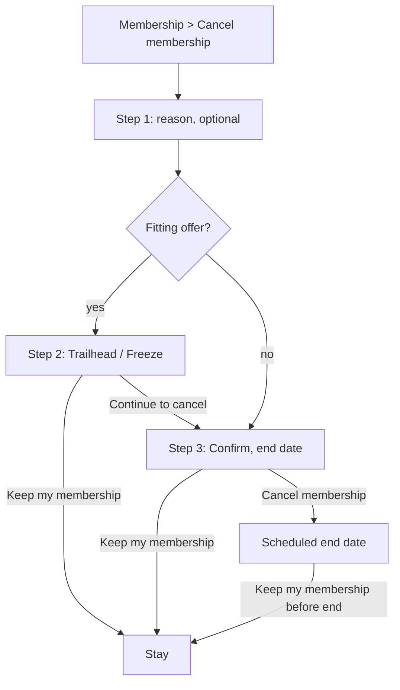

---

## Flow 15 — Update payment method

**Persona:** Maya (M5). **Rules:** card data never touches our servers. The form uses hosted fields from the payment provider (iframes). Pattern: billing card shows brand and last 4 with an "Update payment details" button (W §4 r26; W §3.8).

| # | Screen / state | Member does | System does |
|---|---|---|---|
| 1 | `/billing` PaymentMethodCard: "Visa ending 4821 · expires 11/26" + status "Expires next month" (warning pill when < 60 days). Button "Update payment method". | Presses it. | Step-up auth if needed. Opens dialog `/billing/payment-method`. |
| 2 | Dialog: provider hosted fields — Card number, Expiry, CVC, ZIP — with labels above (Graphical `Field`). Wallet buttons (Apple Pay, Google Pay) when the browser supports them. `Checkbox` (checked) "Use for membership, training and guest passes". | Enters card. | Validates live in the field. |
| 3 | Presses "Save card". Button "Saving…". | | Creates a payment method. If 3-D Secure is required, shows bank dialog. Sets default. |
| 4 | Success: dialog closes, PaymentMethodCard shows new card, toast "Card updated: Mastercard ending 0937." If a payment was failed: also shows "Retrying your Nov 12 payment now…" (Flow 16). | | |

**Errors:** declined "Your bank declined this card. Try another card or call your bank." · incomplete "Check the card number." · expired "That card has expired. Use a card that's valid after Oct 2026." · ZIP "The ZIP code doesn't match the card." · network "We couldn't save your card. Nothing was changed. Try again." · 3-D Secure failed "Your bank couldn't confirm it's you. Try again, or use another card."
**Undo:** the old card stays on file as "Backup" for 30 days; "Make Visa ending 4821 default again" in the card list. A member may remove a non-default card.
**Edge:** a household with a failing payment reaches this dialog from the banner; success returns to the page they came from.

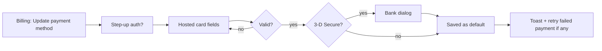

---

## Flow 16 — Failed payment recovery

**Rules** [P13]: retries on day 3 and day 6; full access through day 7; from day 8 new bookings paused; from day 15 pass shows "See the front desk". Pattern: top banner with days left and a CTA (W §4 r28; W §3.8 Buffer); status pill plus second action (W §4 r25).

| Day | System | Member sees |
|---|---|---|
| 0 (Nov 12) | Charge fails. Status `payment_failed`. | Email + push: "Your Nov 12 payment didn't go through. Update your card to keep booking." Global banner (danger-subtle) with "Update card". Membership pill "Payment failed". Billing page top card shows amount and reason ("Card declined"). |
| 3 | Retry 1. | If it fails: reminder email. Banner now says "You have 4 days of full access left." |
| 6 | Retry 2. | Final reminder email + push. |
| 8 | New bookings paused. Existing bookings stay. | Booking buttons show `payment_failed`: "Update card to book". |
| 15 | Membership suspended. | Pass shows "Payment needed. See the front desk." |
| Any | Member pays | Banner clears. Toast "Paid. Your membership is active." Pill "Active". Receipt emailed. Bookings resume immediately. |

| # | Member path | Screen / state |
|---|---|---|
| 1 | Presses "Update card" in banner or email link | `/billing` with PaymentMethodCard in focus and a "Pay $156.00 now" button |
| 2 | **Retry with the same card** ("Try card again") | Spinner; success or error copy |
| 3 | **Update card** (Flow 15) | On save, payment retries automatically |
| 4 | Paid | Green check inline: "Paid $156.00" |

**Edge cases**
- Family adults and teens see a plain note: "Maya needs to update the payment card." with no amounts. They can send a nudge ("Remind Maya") once a day.
- Tone: no shame words (no "delinquent", "overdue" in red). Red is only used for the failed state (W §5 a9).
- Partial failure on add-on charge: shows line items and which failed.
- Cancel during failed state: allowed (Flow 14).
- Freeze during failed state: blocked until paid.

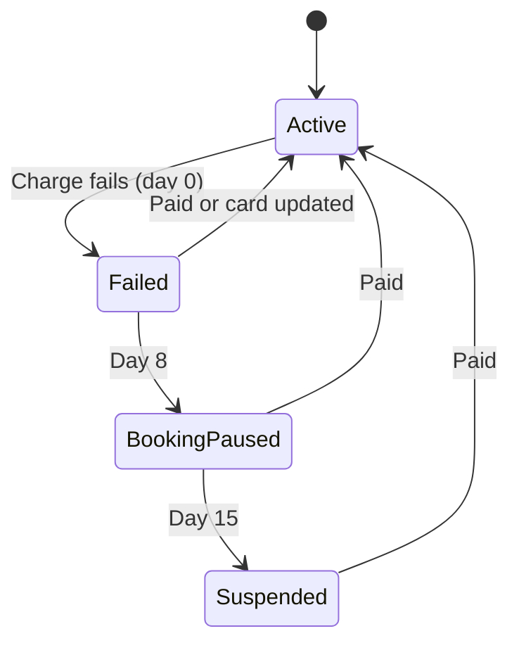

---

## Flow 17 — Add to calendar

**Persona:** Maya (M4), Ron and Linda (R4). **Rules:** all times `America/Phoenix`. Entry points: booking confirmation, booking row menu, reservation confirmation, `/settings/calendar`.

| # | Screen / state | Member does | System does |
|---|---|---|---|
| 1 | "Add to calendar" is a `Menu` button with items: Google Calendar · Apple Calendar (.ics) · Outlook (.ics) · Copy details. | Picks one. | Google: opens a prefilled event URL in a new tab. Apple/Outlook: downloads `climb-cycle-2026-10-27.ics`. |
| 2 | **Single event ICS** has `UID`, `SEQUENCE` (increments on change), `VTIMEZONE America/Phoenix`, location (club address), description (studio, instructor, link to session), `VALARM` 60 minutes before. | Opens the file. | Calendar app adds it. |
| 3 | **Feed** (all bookings): `/settings/calendar` shows secret URL `webcal://my.cactuspeakathletic.com/api/calendar/{token}.ics`, buttons "Copy link", "Subscribe", "Reset link". Options: include household (yes/no), include waitlist (no), include kids club (yes). | Subscribes once. | Feed refreshes (calendar apps poll every 1–24 hours). |

**Edge cases:** Cancelled bookings get `STATUS:CANCELLED` in the feed. "Reset link" makes the old URL return 410: "This link was reset." The feed token is never put in the page URL history; it is revealed on click. Held spots are not in the feed until kept. Time zone note: "Arizona doesn't use daylight saving. Your calendar may shift times if it is set to another zone." Popup blocked for Google → show link.

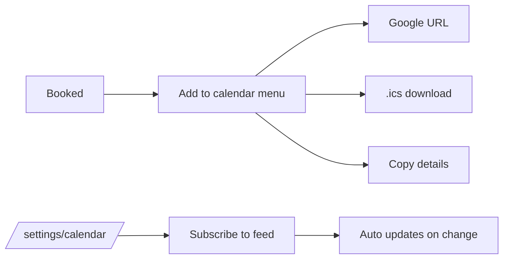

---

## Flow 18 — Check-in pass on the web

**Persona:** Jordan (J1), all. **Entry:** top-bar "Pass" button, mobile tab "Pass", `/pass`, ⌘K "Show my pass". Research: still no gym pass in Mobbin (mobbin-standard-pass §3 correction 4: Wallet buttons exist only on non-gym passes, so do not cite them as gym patterns). Nearest: Luma ticket (white rounded QR), Chick-fil-A (large number with label), Wallet button below the pass (G §4, r12–r14). Component: shared `CheckInPass` variants `full`, `compact`, `guest`, `teen` (shared §9.3). Staff scan the QR at the door; no staff UI here.

| # | Screen / state | Member does | System does |
|---|---|---|---|
| 1 | `/pass` page and the top-bar `Dialog`: `CheckInPass` `full`. Photo, name, plan, home club, **member number in large type with a small label above** (G r12), QR in a white rounded square (G r14), caption "Scan at the front desk. Updates every 60 seconds." Below: `ToggleGroup` or `Select` "Show pass for: Maya · Chris · Theo · Ivy" (household only for adults). | Opens page. | Requests a signed pass token (valid 5 minutes), renders QR, refreshes every 60 seconds. Requests Screen Wake Lock so the screen stays on. |
| 2 | Wallet: "Add to Apple Wallet" (shown on Apple devices) / "Add to Google Wallet" (G r13). | Optional. | Issues a wallet pass. |
| 3 | Pass states (shared): `valid` · `frozen` · `past-due` (from day 15: "Payment needed. See the front desk.") · `trial` · `guest`. "Membership ends Dec 12" is an info line on a `valid` pass. | | |
| 4 | Kids club: parent shows the child's pass at the kids club desk. Child's pass lists "Parent: Maya (checked in 8:02 a.m.)". | | |

**Edge cases**
- Offline: shows the last pass saved on this device (up to 24 hours old) with an amber line "Offline. This code may not scan. Show your member number: CP-004-182-337." Static barcode (Code 128) fallback with the member number.
- Brightness: pass uses a white QR panel and high contrast in dark mode. The page cannot set brightness. A hint reads "Turn your screen brightness up."
- Screenshot warning: not needed; token rotates.
- Teen: only own pass. Child: parent's account only.
- Wake lock unsupported: no message; no failure.
- Token fetch fails: keep the last QR for up to 5 minutes, then show "Can't refresh. Show your member number."

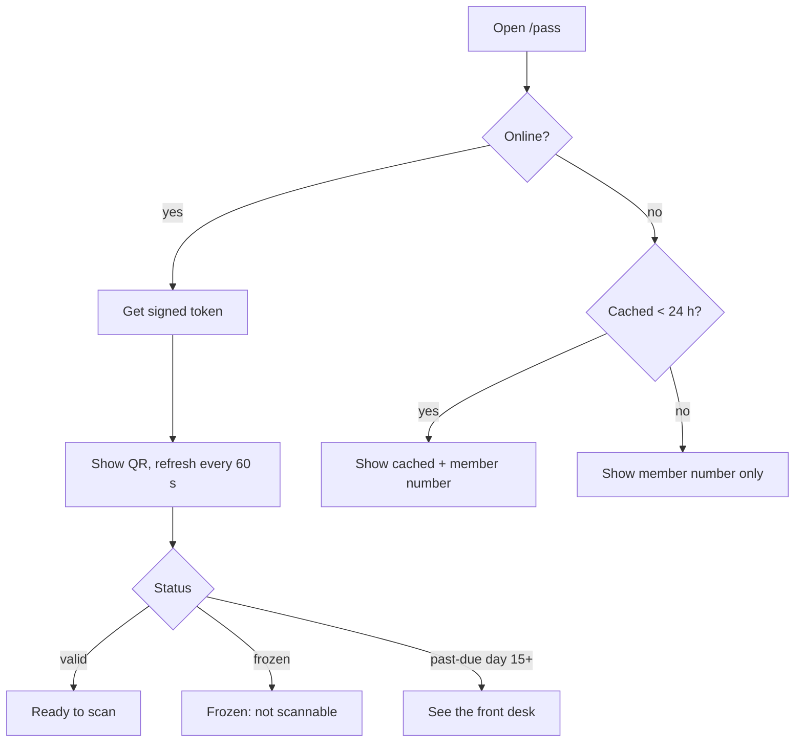

---

## Flow 19 — Teen request and parent approval

**Persona:** Jordan, Alicia (parent). **Entry:** a teen presses a gated action (PT booking, court reservation without permission, class not teen-OK).

| # | Screen / state | Actor | System |
|---|---|---|---|
| 1 | Teen sees `BookingStateButton` `restricted` with the reason "This class needs Alicia's OK." and the link "Ask Alicia". | Jordan presses it | Dialog "Ask Alicia to approve?" with a short note field (optional) and the booking details |
| 2 | Teen presses "Send request" | Jordan | Creates request. Teen sees pill "Waiting for Alicia". Slot is held for 24 hours or until the session starts |
| 3 | Parent gets push, email and an Inbox item "Jordan asked to book Teen Strength Tuesday… Approve?" with **Approve** and **Decline** | Alicia | |
| 4 | Approve → booking is created; teen gets notification. Decline → teen gets "Alicia said not this time." (optional reason) | | |
| 5 | Parent can turn on a permission for good (e.g. "Always allow lap lanes") from the Decline/Approve dialog link "Change Jordan's permissions" | Alicia | Opens `/family/[memberId]` |

**Edge cases:** request expires after 24 hours; the parent is on a frozen account (requests still work); Teen cannot see the cost. Audit: requests are in the parent's Inbox for 30 days.

---

## Flow 20 — Smaller flows

| Flow | Steps |
|---|---|
| **Switch club** | 1 Open ClubSwitcher. 2 Search or pick a club. 3 Page data reloads for that club; heading shows "Viewing Mesa – Dobson" with a "Back to Gilbert – Val Vista" ghost link. Trailhead: locked clubs open browse-only. |
| **Command menu** | ⌘K → type "cycle sat" → arrow to "Climb Cycle · Sat 8:00 a.m. · Mesa – Dobson" → Enter opens the session panel. Esc closes and restores focus. |
| **Mark notifications read** | Open bell → "Mark all read" (toast "All caught up. Undo") or click one row (marks that row; opens its target). |
| **Sign out / devices** | Account menu → Sign out. `/settings/security` lists devices and passkeys with "Sign out" per device and "Sign out everywhere". |
| **Export my data** | `/settings/privacy` → "Download my data (ZIP)". Email link in 24 hours. |
| **Remind me (window opens)** | On a `restricted` button whose reason is "Opens Wed, Oct 28 at 6:00 a.m.", press "Remind me". Push at 5:55 a.m. on opening day: "Saturday classes open at 6:00 a.m." |
| **Leave a waitlist** | `/bookings` > Waitlist > "Leave". Toast "You left the waitlist. Undo." Undo re-joins at the end of the line. |
| **Resend / edit guest pass** | `/guest-passes` row menu. |
| **Private feedback** | After a class ends, the bell shows "How was Climb Cycle?" (no stars; the foundation has no public ratings). The member picks Great / Fine / Not for me and may add a note. It goes to the club, not to other members. Toast "Thanks. We read every note." Past bookings rows show a "Give feedback" link for 7 days. |
| **Change home club** | `/settings/preferences`. Trailhead: allowed once per billing cycle; Ridge and Summit: any time [P12]. |
